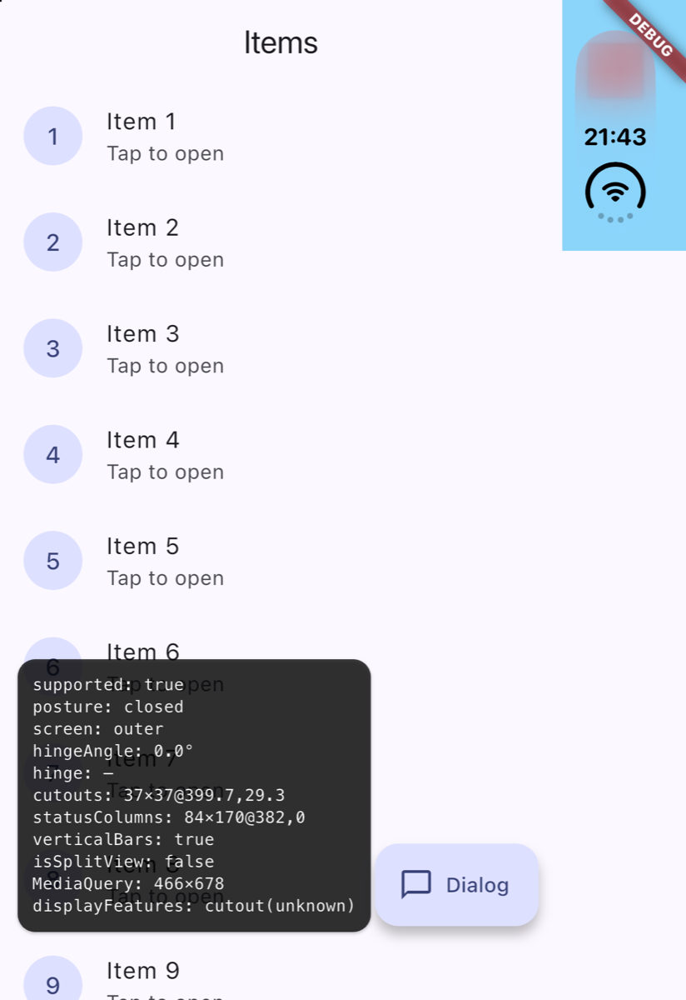
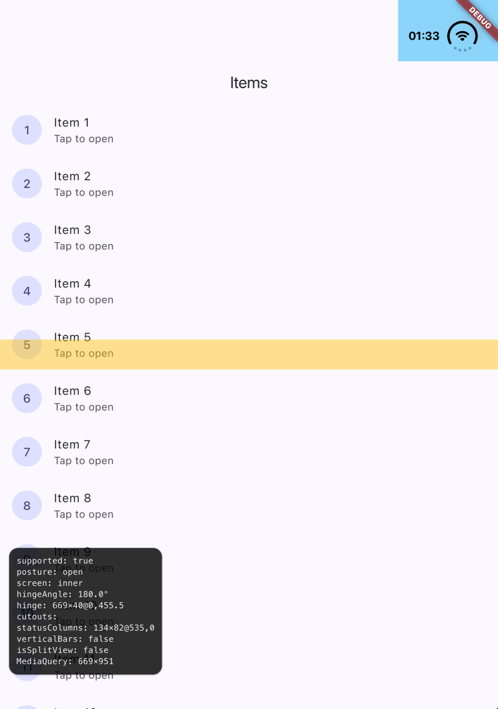
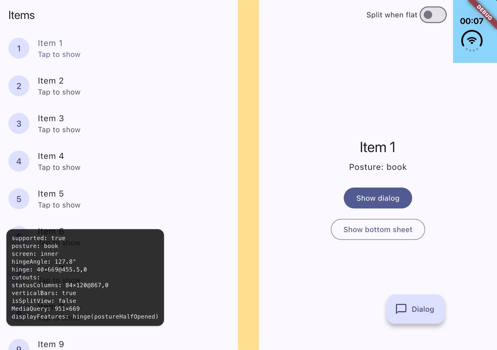

# duo_display

**Bring foldable iPhone support to Flutter.**

Build hinge-aware Flutter apps with native iPhone Duo display information,
seamlessly integrated into `MediaQuery.displayFeatures`.

[](https://pub.dev/packages/duo_display)
[](https://pub.dev/packages/duo_display/score)
[](https://pub.dev/packages/duo_display/score)
[](https://github.com/Geekles007/duo_display/actions/workflows/ci.yml)
[](https://flutter.dev)
[](https://dart.dev)
[](https://github.com/Geekles007/duo_display/blob/main/LICENSE)
[](https://github.com/Geekles007/duo_display)

Flutter reports hinges and folds on Android foldables, but not on iOS.
duo_display reads the iPhone Duo's hinge, posture and camera cutouts from
iOS 27.1 and puts them where your Flutter code already looks.

## See duo_display in action

| Closed | Book (partially open) | Open (flat) |
| --- | --- | --- |
|  |  |  |
| Outer screen. The camera is reported as a `cutout`; there is no hinge. | Inner screen, partially open. A standard Flutter dialog opens on one side of the hinge, with no iPhone-specific code. | Inner screen, flat. The hinge is reported as `postureFlat`. |

Screenshots of the [example app](https://github.com/Geekles007/duo_display/tree/main/example)
on the iPhone Duo simulator (iOS 27.1). Its overlay paints what duo_display
reports: the hinge in amber, cameras in red, status bar areas in blue.

<!-- An animated demo (doc/demo.gif) will replace these screenshots once it is recorded on the simulator. -->

## Why duo_display?

On Android foldables, Flutter fills `MediaQuery.displayFeatures` with the
hinge and fold positions, and widgets such as dialogs, bottom sheets and menus
open on one side of the hinge. On iOS that list stays empty: the iPhone Duo's
geometry is only available through native UIKit APIs introduced in iOS 27.1.

duo_display reads that native geometry and feeds it into the Flutter APIs you
already use:

- **Reuse familiar Flutter APIs.** The hinge and cameras land in
  `MediaQuery.displayFeatures`, the same list Flutter uses on Android.
- **Build hinge-aware interfaces.** Know where the hinge is and whether the
  device is half opened or flat.
- **React to device posture changes.** Listen to closed, book and open
  postures as the user folds the device.
- **Access native display geometry.** Hinge angle, active screen, camera
  cutouts and status bar areas.
- **Avoid platform-specific code.** No Swift or UIKit to write.
- **Safe everywhere else.** On other iPhones, older iOS versions or other
  platforms, it reports unsupported and changes nothing.

## Features

| Feature | Description |
| --- | --- |
| Hinge detection | The band around the fold, in logical pixels, on the inner screen. |
| Device posture | `closed`, `book` or `open`, from the native hinge status. |
| Hinge angle | From 0° (closed) to 180° (flat). |
| Active screen | Whether the app runs on the `outer` or the `inner` screen. |
| Camera cutouts | Active camera areas, also reported as `cutout` display features. |
| Status bar regions | The areas the system status bar reserves, as a column or a band. |
| MediaQuery integration | `DuoDisplayFeatures` adds the hinge and cameras to `MediaQuery.displayFeatures`. |
| Geometry stream | `DuoDisplay.geometry`, a broadcast stream that replays the last geometry to new listeners. |
| Two-pane layout | `DuoLayoutBuilder` splits an area into two panes on either side of the hinge, in its own coordinates. |

## Quick Start

**1. Install the package.**

```sh
flutter pub add duo_display
```

**2. Import it.**

```dart
import 'package:duo_display/duo_display.dart';
```

**3. Wrap your app** in `DuoDisplayFeatures`, above `MaterialApp`:

```dart
void main() => runApp(const DuoDisplayFeatures(child: MyApp()));
```

**4. Read the display features** anywhere below it, with the usual Flutter
API. `DisplayFeature` and its enums come from `dart:ui`.

Complete example:

```dart
import 'dart:ui' show DisplayFeatureType;

import 'package:duo_display/duo_display.dart';
import 'package:flutter/material.dart';

void main() => runApp(const DuoDisplayFeatures(child: MyApp()));

class MyApp extends StatelessWidget {
  const MyApp({super.key});

  @override
  Widget build(BuildContext context) {
    return const MaterialApp(home: HingePage());
  }
}

class HingePage extends StatelessWidget {
  const HingePage({super.key});

  @override
  Widget build(BuildContext context) {
    final hinge = MediaQuery.displayFeaturesOf(context)
        .where((feature) => feature.type == DisplayFeatureType.hinge)
        .firstOrNull;
    return Scaffold(
      body: Center(
        child: Text(
          hinge == null
              ? 'No hinge on this screen'
              : 'Hinge at ${hinge.bounds} (${hinge.state.name})',
        ),
      ),
    );
  }
}
```

On an iPhone Duo in Book posture, this shows the hinge band and
`postureHalfOpened`. Closed, on another device or on another platform, it
shows "No hinge on this screen".

## How It Works

```text
iOS 27.1 native APIs
  UIHingeInteraction · UIView.reservedRegions · verticalBarEdge
        ↓
duo_display, native side (Swift)
  an invisible view pinned to the Flutter view reads the geometry
  and sends a snapshot once it has settled
        ↓  Pigeon platform channel
duo_display, Dart side
  DuoGeometry · DuoDisplay.geometry
        ↓
DuoDisplayFeatures
  MediaQuery.displayFeatures
        ↓
Your widgets
```

- **Native layer.** An invisible view pinned to the Flutter view re-reads the
  hinge, the reserved regions and the active screen on every layout pass, safe
  area change, trait change and hinge update. Once the geometry has been
  stable for 150 ms, it sends a snapshot. This filters out the intermediate
  states iOS reports while the device folds or rotates.
- **Bridge.** A typed [Pigeon](https://pub.dev/packages/pigeon) channel carries
  the raw snapshot to Dart.
- **Flutter integration.** The Dart side turns it into a `DuoGeometry`
  (posture, hinge, cutouts…), exposes it through `DuoDisplay`, and
  `DuoDisplayFeatures` writes the hinge and cameras into
  `MediaQuery.displayFeatures`.

## Usage Examples

duo_display never rearranges your screens on its own. Widgets that already
read `MediaQuery.displayFeatures` adapt by themselves: dialogs, bottom sheets
and menus open on one side of the hinge. For your own screens,
`DuoLayoutBuilder` (example F) hands you the two panes; examples A to E read
the underlying information.

### A. Reading display features

```dart
for (final feature in MediaQuery.displayFeaturesOf(context)) {
  debugPrint('${feature.type.name} ${feature.state.name} ${feature.bounds}');
}
```

In Book posture, in landscape, this prints
`hinge postureHalfOpened Rect.fromLTRB(455.5, 0.0, 495.5, 669.0)`.

### B. Detecting device posture

```dart
StreamBuilder<DuoGeometry>(
  stream: DuoDisplay.geometry,
  builder: (context, snapshot) {
    final posture = snapshot.data?.posture ?? DuoPosture.unsupported;
    return Text(switch (posture) {
      DuoPosture.closed => 'Closed: outer screen',
      DuoPosture.book => 'Book: partially open',
      DuoPosture.open => 'Open: flat',
      DuoPosture.unsupported => 'Not an iPhone Duo',
    });
  },
)
```

The text follows the device as it folds. It reads "Not an iPhone Duo" until
the first geometry arrives, and stays so on unsupported devices.

### C. Listening to geometry changes

```dart
class PostureLogger extends StatefulWidget {
  const PostureLogger({super.key});

  @override
  State<PostureLogger> createState() => _PostureLoggerState();
}

class _PostureLoggerState extends State<PostureLogger> {
  StreamSubscription<DuoGeometry>? _subscription;

  @override
  void initState() {
    super.initState();
    _subscription = DuoDisplay.geometry.listen((geometry) {
      final posture = geometry.posture.name;
      debugPrint('$posture on the ${geometry.screen.name} screen');
    });
  }

  @override
  void dispose() {
    _subscription?.cancel();
    super.dispose();
  }

  @override
  Widget build(BuildContext context) => const SizedBox.shrink();
}
```

Each new listener first receives the last known geometry, then every change.
For one-off reads, use `await DuoDisplay.isSupported` and
`await DuoDisplay.current()`. `StreamSubscription` comes from `dart:async`.

### D. Accessing hinge information

```dart
Widget hingeLabel(DuoGeometry geometry) {
  final hinge = geometry.hinge; // null unless the app is on the inner screen
  final angle = geometry.hingeAngle; // in degrees, null until known
  if (hinge == null || angle == null) return const Text('No hinge');
  return Text('Hinge ${hinge.width} pt wide, at ${angle.round()}°');
}
```

On the inner screen in Book posture, this shows a 40 pt band at about 128°.
The same band is in `MediaQuery.displayFeatures` as a `hinge`, with
`postureHalfOpened` in Book and `postureFlat` when open.

### E. Working with camera cutouts

```dart
// Active cameras, also reported as cutout display features by default.
final cameras = geometry.cutouts;

// Status bar areas: never display features, only in the geometry.
final statusAreas = geometry.statusColumns;

// Report the hinge only, without cameras.
runApp(const DuoDisplayFeatures(includeCutouts: false, child: MyApp()));
```

When the device is closed, `cutouts` holds the outer camera (37×37 pt). iOS
reports the inner camera as inactive, so the inner screen has no cutout.

### F. Laying out two panes around the hinge

```dart
DuoLayoutBuilder(
  builder: (context, layout) => layout.place(
    first: const ItemList(),
    second: const ItemDetail(),
  ),
)
```

`DuoLayoutBuilder` hands its builder a `DuoLayout`: two panes, `first` and
`second`, on either side of the hinge, or a single one (`first`, the whole
area) when nothing splits it. `place` puts a widget in each pane and leaves
the hinge empty; when the area is not split, it shows `first` alone and never
builds `second`. `first` keeps its state when the split changes. For anything
else, use `isSplit`, `axis`, `first`, `second` and `hinge` directly.

| iPhone Duo | `DuoLayout` |
| --- | --- |
| Closed | One pane: the outer screen has no hinge. |
| Book, landscape | Side by side, 455.5 pt each, around the 40 pt hinge band. |
| Book, portrait | Stacked, split at the fold's real height, even under an app bar. |
| Flat | One pane, or two with `splitWhenFlat: true`. |

- `first` is the leading pane: on the left (on the right with right-to-left
  text) when the panes sit side by side, at the top when they are stacked.
- Rectangles are in logical pixels, relative to the builder, wherever it sits
  on screen.
- The builder reads `MediaQuery.displayFeatures`. On iOS, `DuoDisplayFeatures`
  must be above it; on Android foldables, Flutter reports display features
  itself, so the same code splits there too.
- It measures where it sits after every frame, so it follows page
  transitions and swipes and lands on the fold once they stop. The very first
  frame assumes the top left corner of the screen: when the builder sits
  elsewhere, under an app bar in portrait or next to a navigation rail in
  landscape, that one frame splits at the wrong place and the next one is
  correct. Rotation or scaling by an ancestor is not compensated.
- In a scrolling list the constraints are unbounded along the scroll axis, so
  the area never splits. Pages of a `PageView` or `TabBarView` are bounded and
  split normally.

## Understanding Device Postures

| Posture | Description | Display Features |
| --- | --- | --- |
| `DuoPosture.closed` | Folded. The app runs on the outer screen (466×678 pt). | The outer camera as a `cutout`, state `unknown`. No hinge. |
| `DuoPosture.book` | Partially open, like a book. The app runs on the inner screen (951×669 pt in landscape). | The hinge band as a `hinge`, state `postureHalfOpened`. |
| `DuoPosture.open` | Open as far as the device allows: flat. Inner screen. | The hinge band as a `hinge`, state `postureFlat`. |
| `DuoPosture.unsupported` | Not an iPhone Duo, iOS older than 27.1, another platform, or no data yet. | Nothing is added. |

`DuoGeometry.screen` says which screen hosts the Flutter view: `outer`,
`inner` or `unknown`.

## Requirements

| Requirement | Version |
| --- | --- |
| Flutter | 3.44 or later |
| Dart | 3.12.2 or later (within 3.x) |
| Xcode | 27.1 or later. The plugin uses iOS 27.1 SDK APIs and does not compile with an older SDK. |
| iOS deployment target | 15.0 or later. Xcode 27.1 rejects lower targets. |
| Runtime | iOS 27.1 on an iPhone Duo. Elsewhere, the plugin reports unsupported and does nothing. |
| Platforms | iOS only. On Android, Flutter already reports display features itself. |

Flutter templates still target iOS 13.0. Raise the target in `ios/Podfile`:

```ruby
platform :ios, '15.0'

post_install do |installer|
  installer.pods_project.targets.each do |target|
    flutter_additional_ios_build_settings(target)
    target.build_configurations.each do |config|
      if config.build_settings['IPHONEOS_DEPLOYMENT_TARGET'].to_f < 15.0
        config.build_settings['IPHONEOS_DEPLOYMENT_TARGET'] = '15.0'
      end
    end
  end
end
```

Then set `IPHONEOS_DEPLOYMENT_TARGET` to `15.0` in the Runner target.

## Testing

Currently tested on the iOS simulator. Physical-device feedback is welcome.

1. Install the iOS 27.1 simulator runtime. Without `-buildVersion`, Xcode 27.1
   downloads the 27.0 runtime:

   ```sh
   xcodebuild -downloadPlatform iOS -buildVersion 27.1
   ```

2. Create an iPhone Duo simulator:

   ```sh
   xcrun simctl create "Duo-27.1" com.apple.CoreSimulator.SimDeviceType.iPhone-Duo com.apple.CoreSimulator.SimRuntime.iOS-27-1
   ```

3. Run your app or the example on it, then change postures (Closed, Book,
   Open, Rotate Right) in Device Hub, which replaces Simulator.app in Xcode
   27.1. `simctl` has no posture command. Device Hub presets sometimes stop
   short of their target, for instance Open at 174°: apply them again if the
   posture looks wrong.

The package's own tests run with `flutter test`. They check the geometry
mapping against captures from the simulator, and continuous integration runs
them with `flutter analyze` on every change.

## Known Limitations

- **Physical-device validation pending.** Tested on the iOS 27.1 simulator
  only. If you own an iPhone Duo,
  [reports are welcome](https://github.com/Geekles007/duo_display/issues).
- **Single Flutter view.** Add-to-app and multiple Flutter views are untested.
- **Geometry update delay.** Updates arrive about 150 ms after the geometry
  settles, which filters out the intermediate states iOS reports during folds
  and rotations.
- **Layout is opt-in.** Only the widgets you lay out with `DuoLayoutBuilder`
  avoid the hinge; the rest of your screens stay as they are.
- **Cameras and status bar areas are told apart by geometry.** iOS gives no
  way to identify them: a status bar area touches an edge of the screen, a
  camera never does.
- **No cutout on the inner screen.** iOS reports the inner camera as
  inactive.
- **Xcode 27.1 is required to build**, even for apps that only run on older
  iOS versions.
- **Simulator redraw delay.** On the iPhone Duo simulator's inner screen,
  idle Flutter apps can redraw several seconds after an input. A bare Flutter
  app without duo_display behaves the same, and other simulators do not.

## Example App

The [example app](https://github.com/Geekles007/duo_display/tree/main/example)
is a list and detail app wrapped in `DuoDisplayFeatures`. It shows:

- `DuoLayoutBuilder` at work: in Book, the list and the selected item sit on
  either side of the hinge; a switch in the app bar also splits the screen
  when the device is flat;
- an overlay that paints the hinge (amber), cameras (red) and status bar
  areas (blue), with a card listing every `DuoGeometry` value and the display
  features Flutter sees;
- dialog and bottom sheet buttons, to see them open on one side of the hinge.



Run it on the iPhone Duo simulator:

```sh
cd example
flutter run -d Duo-27.1
```

## Roadmap

**Implemented**

- `DuoDisplayFeatures`: the hinge and cameras in `MediaQuery.displayFeatures`.
- `DuoDisplay`: geometry stream, `current()` and `isSupported`.
- `DuoGeometry`: posture, hinge angle, active screen, hinge band, cutouts,
  status bar areas, vertical bars and split view.
- `DuoLayoutBuilder`: two panes around the hinge, also on Android foldables.

**Planned**

- Physical-device validation, with help from iPhone Duo owners.

**Ideas**

- An animated demo recorded on the simulator, to replace the screenshots.
- More examples, such as a navigation rail beside the hinge.

## Contributing

Contributions are welcome:

- **Bug reports** and **feature requests**: open an
  [issue](https://github.com/Geekles007/duo_display/issues). For bugs, include
  your Flutter, Xcode and iOS versions and the device or simulator.
- **Device testing feedback**: if you own an iPhone Duo, run the example app
  in each posture and share a screenshot of the overlay in an issue.
- **Pull requests**: run `flutter analyze` and `flutter test` before opening
  one; continuous integration runs both.

To work on the native side, `tool/probe` holds DuoProbe, a single-file UIKit
app that logs the raw geometry: `tool/probe/run.sh` builds and launches it on
the simulator (`VSYNC=1` also logs display link ticks), and
`tool/probe/snap.sh <pose>` saves the settled geometry as a test fixture. Regenerate the channel code with
`dart run pigeon --input pigeons/messages.dart`.

## License

duo_display is released under the
[MIT License](https://github.com/Geekles007/duo_display/blob/main/LICENSE).
