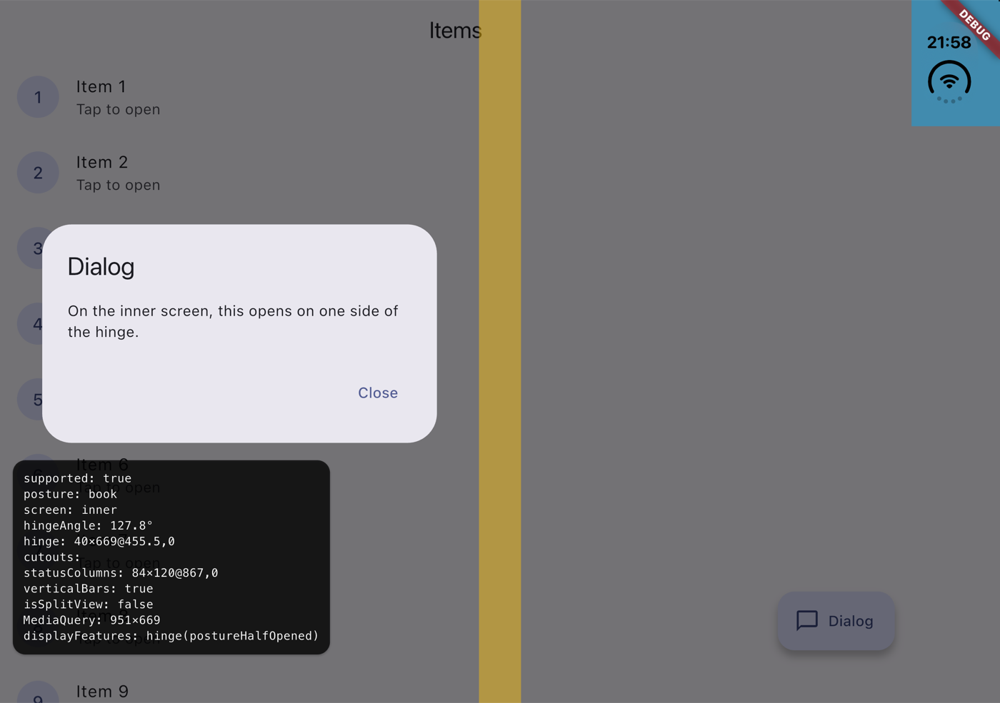

# duo_display

iPhone Duo support for Flutter. The hinge, the posture and the camera cutouts
of Apple's first foldable are reported through `MediaQuery.displayFeatures`,
the same way Flutter already reports them on Android foldables, and
`DuoLayoutBuilder` lays out two panes on either side of the hinge.



## Why

On Android foldables, Flutter fills `MediaQuery.displayFeatures` and widgets
such as dialogs, bottom sheets and menus open on one side of the hinge. On iOS
the list stays empty. iOS 27.1 exposes the iPhone Duo geometry through new
UIKit APIs (`UIHingeInteraction`, `UIView.reservedRegions`); this plugin
bridges them, so foldable-aware Flutter code works on the iPhone Duo without
any Apple-specific code.

## Requirements

| | |
| --- | --- |
| Xcode | 27.1 or later. The plugin uses iOS 27.1 SDK APIs and does not compile with an older SDK. |
| iOS deployment target | 15.0 or later. Xcode 27.1 rejects lower targets. |
| Flutter | 3.44 or later. |
| At runtime | iOS 27.1 on an iPhone Duo. Anywhere else the plugin reports unsupported and does nothing. |

Flutter templates still target iOS 13.0. Raise it in `ios/Podfile`:

```ruby
platform :ios, '15.0'

post_install do |installer|
  installer.pods_project.targets.each do |target|
    flutter_additional_ios_build_settings(target)
    target.build_configurations.each do |config|
      if config.build_settings['IPHONEOS_DEPLOYMENT_TARGET'].to_f < 15.0
        config.build_settings['IPHONEOS_DEPLOYMENT_TARGET'] = '15.0'
      end
    end
  end
end
```

and set `IPHONEOS_DEPLOYMENT_TARGET` to `15.0` in the Runner target.

## Install

```sh
flutter pub add duo_display
```

## Usage

### Display features

Wrap your app:

```dart
import 'package:duo_display/duo_display.dart';

void main() => runApp(const DuoDisplayFeatures(child: MyApp()));
```

Every widget below now sees the iPhone Duo in `MediaQuery.displayFeatures`:

| iPhone Duo | `MediaQuery.displayFeatures` |
| --- | --- |
| Book (partially open) | `hinge`, `postureHalfOpened`: the 40 pt band around the fold, margins included |
| Open (flat) | `hinge`, `postureFlat` |
| Closed | no hinge: the outer screen has none |
| Active camera | `cutout`, `unknown`. Pass `includeCutouts: false` to leave cameras out. |

The status bar column is not a display feature. It is available in
`DuoGeometry.statusColumns`. If the Flutter engine already reports display
features, `DuoDisplayFeatures` leaves them untouched.

### Raw geometry

```dart
StreamBuilder<DuoGeometry>(
  stream: DuoDisplay.geometry,
  builder: (context, snapshot) {
    final geometry = snapshot.data;
    if (geometry?.posture == DuoPosture.book) {
      // ...
    }
    // ...
  },
);
```

`DuoDisplay.geometry` is a broadcast stream: each new listener first gets the
last known geometry. `DuoDisplay.current()` and `DuoDisplay.isSupported` are
one-off queries. Use them from widgets, or after
`WidgetsFlutterBinding.ensureInitialized()`.

| `DuoGeometry` | |
| --- | --- |
| `posture` | `closed`, `book`, `open`, or `unsupported` |
| `hingeAngle` | in degrees, 0 (closed) to 180 (flat) |
| `screen` | `outer`, `inner`, or `unknown` |
| `hinge` | the band around the fold, on the inner screen |
| `cutouts` | active camera areas |
| `statusColumns` | active status bar areas: a column when bars are vertical, a band otherwise |
| `verticalBars` | whether the system places its bars along one edge |
| `isSplitView` | whether the window is smaller than the screen |

Rectangles are in logical pixels, in the Flutter view's coordinate space, like
everything else in `MediaQuery`.

### Two panes around the hinge

```dart
DuoLayoutBuilder(
  builder: (context, layout) => layout.place(
    first: const ItemList(),
    second: const ItemDetail(),
  ),
)
```

`DuoLayoutBuilder` hands its builder a `DuoLayout`: two panes, `first` and
`second`, on either side of the hinge, or a single one (`first`, the whole
area) when nothing splits it. `place` puts a widget in each pane and leaves
the hinge empty; when the area is not split, it shows `first` alone and never
builds `second`. For anything else, use `isSplit`, `axis`, `first`, `second`
and `hinge` directly.

| iPhone Duo | `DuoLayout` |
| --- | --- |
| Closed | One pane: the outer screen has no hinge. |
| Book, landscape | Side by side, 455.5 pt each, around the 40 pt hinge band. |
| Book, portrait | Stacked, split at the fold's real height, even under an app bar. |
| Flat | One pane, or two with `splitWhenFlat: true`. |

- `first` is the leading pane: on the left (on the right with right-to-left
  text) when the panes sit side by side, at the top when they are stacked.
- Rectangles are in logical pixels, relative to the builder, wherever it sits
  on screen.
- The builder reads `MediaQuery.displayFeatures`. On iOS, `DuoDisplayFeatures`
  must be above it; on Android foldables, Flutter reports display features
  itself, so the same code splits there too.
- It measures where it sits after every frame, so it follows page
  transitions and swipes and lands on the fold once they stop. The very first
  frame assumes the top left corner of the screen: when the builder sits
  elsewhere, under an app bar in portrait or next to a navigation rail in
  landscape, that one frame splits at the wrong place and the next one is
  correct. Rotation or scaling by an ancestor is not compensated.
- In a scrolling list the constraints are unbounded along the scroll axis, so
  the area never splits. Pages of a `PageView` or `TabBarView` are bounded and
  split normally.

## Testing on the simulator

1. Install the iOS 27.1 simulator runtime. Without `-buildVersion`, Xcode 27.1
   downloads the 27.0 runtime:

   ```sh
   xcodebuild -downloadPlatform iOS -buildVersion 27.1
   ```

2. Create an iPhone Duo simulator:

   ```sh
   xcrun simctl create "Duo-27.1" com.apple.CoreSimulator.SimDeviceType.iPhone-Duo com.apple.CoreSimulator.SimRuntime.iOS-27-1
   ```

3. Change poses (Closed, Book, Open, Rotate Right) in Device Hub, which
   replaces Simulator.app in Xcode 27.1. `simctl` has no pose command. Device
   Hub presets sometimes stop short of the target, for instance Open at 174°:
   apply them again if the posture looks wrong.

The [example app](example) shows its list and detail on either side of the
hinge in Book, draws the hinge, cutouts and status columns over it, and opens
dialogs and bottom sheets to show them avoid the hinge.

## Limitations

- Tested on the iOS 27.1 simulator only. If you own an iPhone Duo, reports
  are welcome: [open an issue](https://github.com/Geekles007/duo_display/issues).
- UIKit's region identifiers are opaque, so cameras and status columns are
  told apart by geometry: a status column touches an edge of the view, a
  camera never does.
- iOS reports the inner camera as inactive, so the inner screen has no cutout.
- Updates arrive about 150 ms after the geometry settles, which filters out
  the intermediate states iOS emits while the device folds or rotates.
- A single Flutter view is supported. Add-to-app and multiple views are
  untested.

## Known issues

- On the iPhone Duo simulator, while the inner screen is in use, Flutter apps
  redraw several seconds after an input when they are otherwise idle: a tap
  seems ignored, then shows up. A bare Flutter app without duo_display behaves
  the same, the iPhone 17 Pro simulator (iOS 26.4) does not, and UIKit apps on
  the iPhone Duo simulator update immediately. Whether real devices are
  affected is unknown until the iPhone Duo ships.

## How it works

An invisible `UIView` pinned to the Flutter view re-reads the reserved regions,
the vertical bar edge and the scene's screen on every layout pass, safe area
change, vertical bar trait change and `UIHingeInteraction` update. Once the
geometry has been stable for 150 ms, a snapshot goes to Dart through
[Pigeon](https://pub.dev/packages/pigeon), where it is interpreted and unit
tested against captures from the simulator.

## Contributing

`tool/probe` holds DuoProbe, a single-file UIKit app that logs the raw
geometry as JSON lines. `tool/probe/run.sh` builds and launches it on the
simulator, and `tool/probe/snap.sh <pose>` saves the settled geometry as a
test fixture in `test/fixtures`. Regenerate the channel code with
`dart run pigeon --input pigeons/messages.dart`.

## License

MIT
